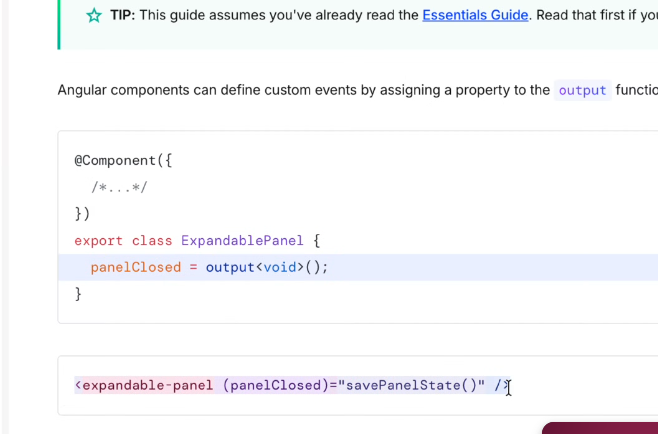
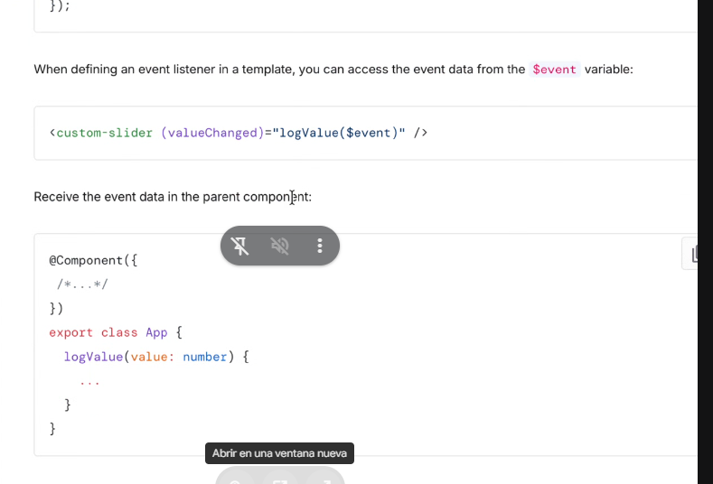

ºbgn

Para comunicarse se utilizando dos propiedas:

property binding y event binding

property binding se comunica el padre con el hijo y event bindig el hijo con el padre

Los input generan propiedades de entrada y los output eventos de salida

El nombre de la izquierda es el nombre del elemento (Siempre un verbo) --> `panelClosed= output = <void>();`

En el elemnto padre: 

usando `this.panelClosed.emit()` emito el valor hacia arriba

En el padre: 

endº
