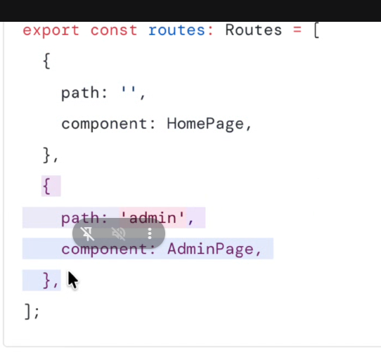
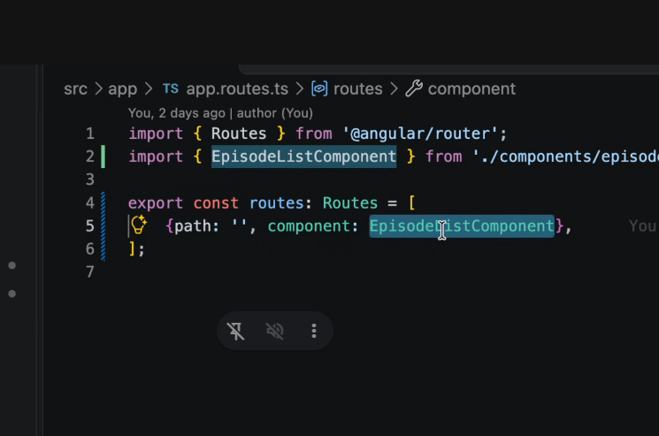
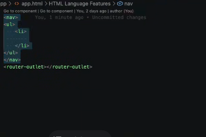
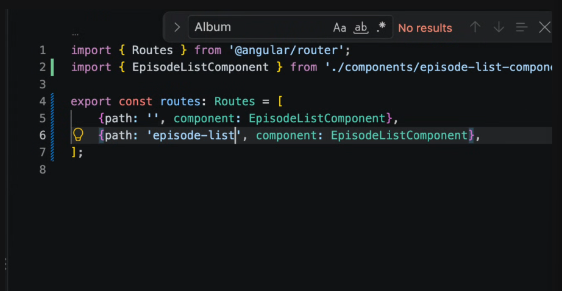
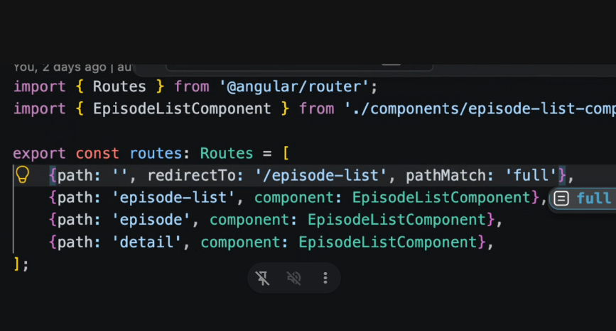
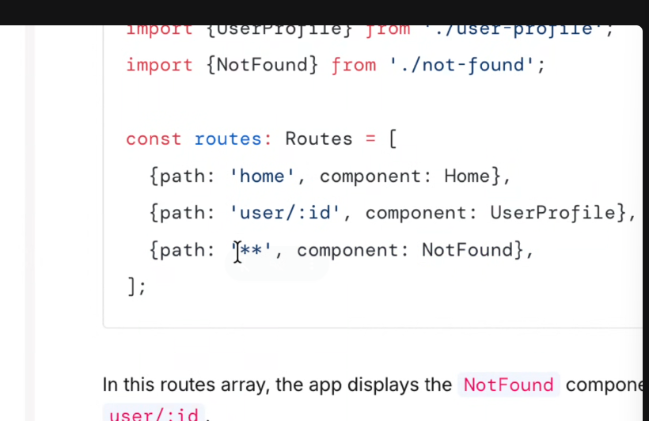
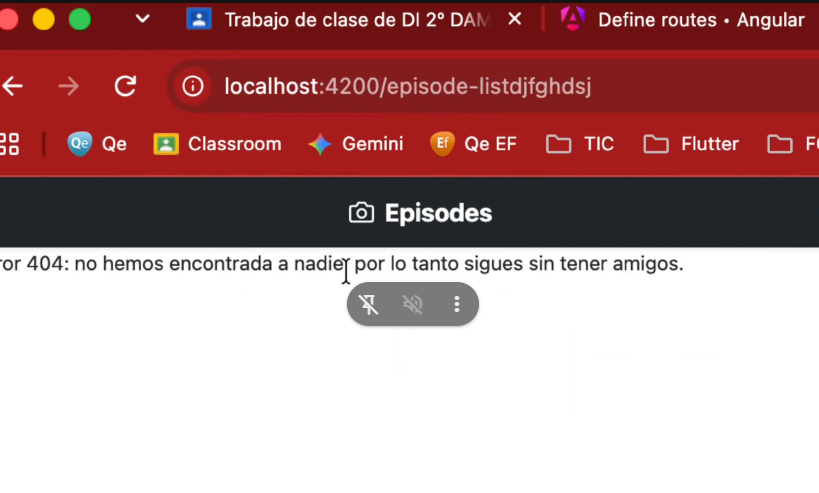
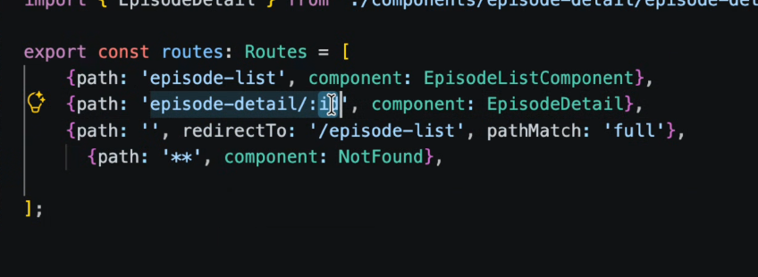
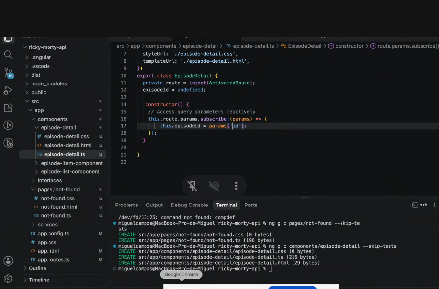

º

Cada llave es una ruta

En nuestro project tenemos un archivo llamado routes.ts que tiene un array de rutas que está vacio:

router outlet es el que se encarga de cargar los componentes según la ruta

Que te cargue la lista de episodios, muy oarecido a thymleaf

Angular va recorriendo las listas de arriba a bajo,
y va comprobando por sluts, si esta la palabra hace un match

Para que mire que todo esta vacío

Para poner el el default, osea que coja cualquier cosa, lo suyo es crear una pagina not found

El nombre del parametro dinamico.

Como obtener el parametro del url, y lo demás es lo de siempre

## query paramas

